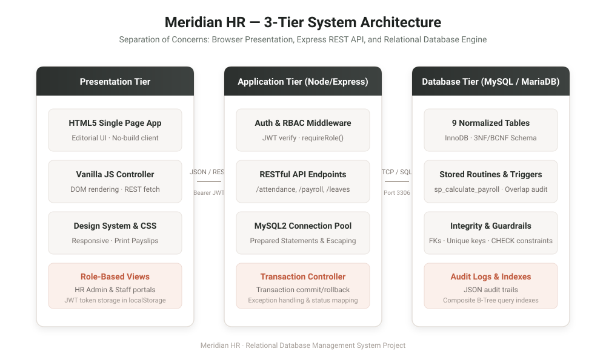
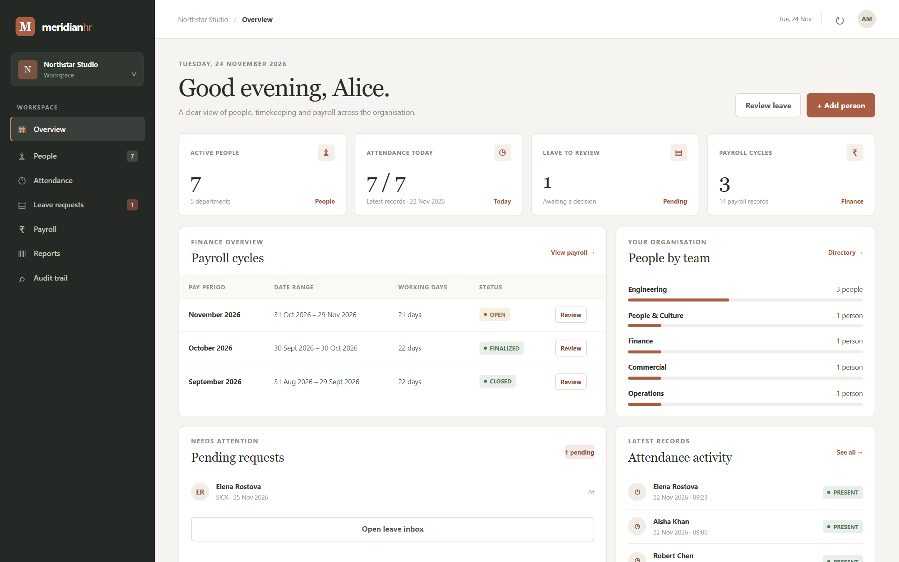
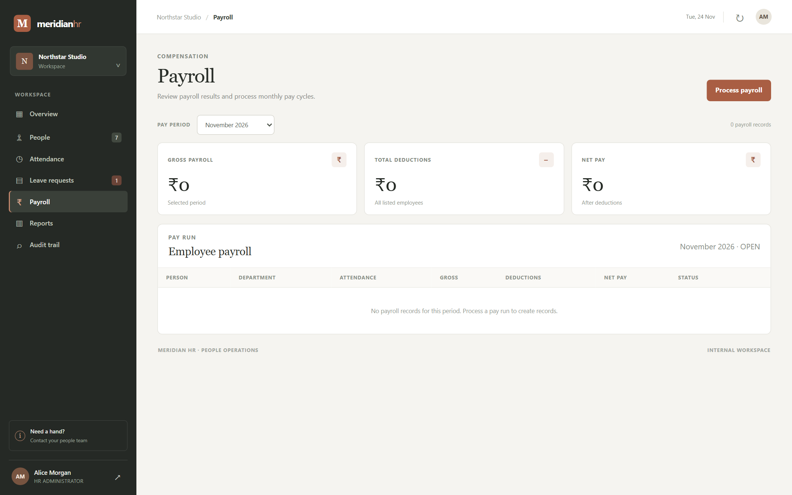
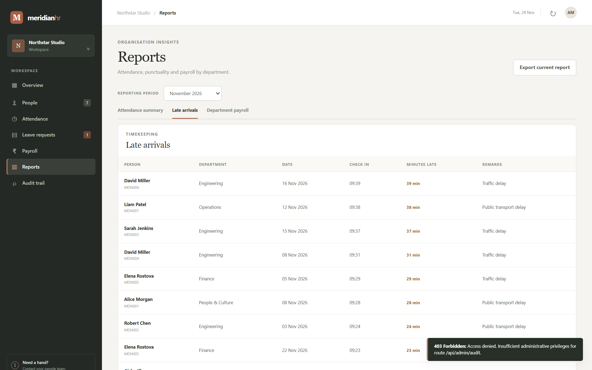
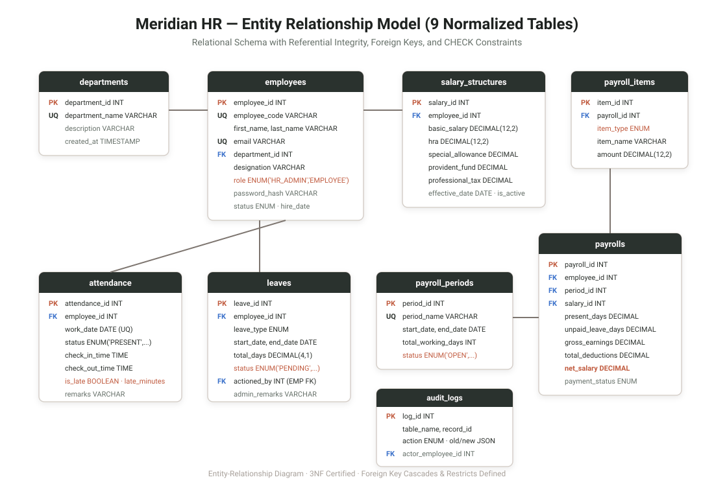

# Meridian HR — Payroll & Attendance Management System

[](https://nodejs.org/)
[](https://www.mysql.com/)
[](tests/test_suite.js)
[](#academic-phase-structure-100-marks-total)
[](Meridian_HR_Project_Report.pdf)

**Meridian HR** is an auditable, transaction-safe, and relational Payroll & Attendance Management System built as an end-to-end Database Management System (DBMS) capstone project. It demonstrates relational schema modeling (3NF/BCNF), procedural SQL calculations, query optimization, role-based security isolation (RBAC), atomic transaction safety (`COMMIT` / `ROLLBACK`), and modern full-stack web integration.

The interface is crafted in a warm, editorial operations style with clear data tables, intuitive timekeeping, and itemized compensation vouchers.

---

## Key Features

1. **Explainable Salary Calculations:** Itemized breakdown of gross earnings, basic salary, house rent allowance (HRA), special allowances, statutory provident fund (PF), professional tax, unpaid leave deductions, punctuality penalties, and progressive TDS income tax.
2. **Attendance & Leave Temporal Guardrails:** Database-level constraints and triggers preventing duplicate daily attendance, check-out before check-in, and overlapping approved leave requests.
3. **Transaction Safety:** ACID-compliant payroll processing using stored procedures (`sp_calculate_payroll`) with explicit error handling and verified `ROLLBACK` on constraint failure.
4. **Historical Snapshot Preservation:** Finalized payroll records preserve immutable monetary snapshots so future compensation revisions never alter historical pay slips.
5. **Role-Based Data Isolation:** Server-side JWT authentication and route middleware guarantee that employees can access only their own authorized attendance, leave, and salary records.

---

## Academic Phase Structure (100 Marks Total)

| Phase | Title | Marks | Key Deliverables | Status |
| :---: | :--- | :---: | :--- | :---: |
| **Phase 1** | Data Modeling & Schema Design | 20 | 9 Normalized Tables, 3NF Proof, ER Diagram, SQL DDL | **Completed & Verified** |
| **Phase 2** | Procedural Implementation | 20 | Stored Functions, Procedures, Triggers, Sample Organisation Seed | **Completed & Verified** |
| **Phase 3** | Query & Report Development | 20 | Attendance Summary, Salary Slips, Late-Marks Report, Index Optimization | **Completed & Verified** |
| **Phase 4** | Security, RBAC & Testing | 20 | RBAC Matrix, 20/20 Passing Automated Tests, Transaction Rollback Demo | **Completed & Verified** |
| **Phase 5** | Full-Stack Integration & UI | 20 | Connected Web Interface, 11-Screen UI Gallery, Project Report PDF | **Completed & Verified** |

---

## Visual Interface & Architecture Deliverables

### System Architecture


*Technical Diagram Downloads:*
- **Entity-Relationship Model:** [[Vector SVG](docs/assets/diagrams/er-diagram.svg)]
- **System Architecture:** [[Vector SVG](docs/assets/diagrams/system-architecture.svg)]
- **Comprehensive Project Report:** [[Academic PDF Report](Meridian_HR_Project_Report.pdf)]

---

### Core UI Gallery

| View | Description | Screenshot Preview |
| :--- | :--- | :--- |
| **HR / Admin Dashboard** | Real-time aggregate metrics, attendance tracking, and cycle management |  |
| **Itemized Salary Slip** | Sarah Jenkins payslip with itemized earnings, deductions, and net voucher |  |
| **RBAC Security Enforcement** | Direct object access / tampering blocked with HTTP 403 alert |  |

<details open>
<summary><strong>Click to expand the complete 11-screen UI capture index</strong></summary>

| # | Screen Name | Path | Description |
|---|---|---|---|
| 01 | **Login Screen** | [`01-login.png`](docs/assets/screenshots/01-login.png) | Authentication portal with 1-click evaluation shortcuts |
| 02 | **HR Dashboard** | [`02-hr-dashboard.png`](docs/assets/screenshots/02-hr-dashboard.png) | High-level organizational KPI metrics and quick actions |
| 03 | **Employee Dashboard** | [`03-employee-dashboard.png`](docs/assets/screenshots/03-employee-dashboard.png) | Self-service compensation overview and punch clock |
| 04 | **Employee Roster** | [`04-employee-roster.png`](docs/assets/screenshots/04-employee-roster.png) | Employee directory across 5 departments |
| 05 | **Attendance Log** | [`05-attendance-management.png`](docs/assets/screenshots/05-attendance-management.png) | Daily check-in log and punctuality badges |
| 06 | **Leave Workflow** | [`06-leave-workflow.png`](docs/assets/screenshots/06-leave-workflow.png) | Leave application modal and HR approval/rejection queue |
| 07 | **Payroll Cycle** | [`07-payroll-processing.png`](docs/assets/screenshots/07-payroll-processing.png) | Monthly cycle calculation and status monitoring |
| 08 | **Itemized Salary Slip** | [`08-itemized-salary-slip.png`](docs/assets/screenshots/08-itemized-salary-slip.png) | Itemized earnings, statutory deductions, and net pay voucher |
| 09 | **Attendance Report** | [`09-monthly-attendance-report.png`](docs/assets/screenshots/09-monthly-attendance-report.png) | Phase 3 monthly attendance analytical summary |
| 10 | **Late-Marks Report** | [`10-late-marks-report.png`](docs/assets/screenshots/10-late-marks-report.png) | Phase 3 analytical ranking of tardy arrivals (>09:15) |
| 11 | **Access Denied** | [`11-access-denied-behavior.png`](docs/assets/screenshots/11-access-denied-behavior.png) | Server & client RBAC 403 Forbidden protection against snooping |

</details>

---

## One-Click Demo Credentials

The bundled seed dataset contains pre-configured evaluation accounts. One-click demo buttons are provided on the login portal:

| Role | Name | Email | Password | Allowed Capabilities |
|---|---|---|---|---|
| **HR Administrator** | Alice Morgan | `alice.morgan@meridian.local` | `Admin123!` | Full roster management, execute payroll cycles, approve leaves, generate analytical reports, view audit logs, test transaction rollback. |
| **Staff Employee** | Sarah Jenkins | `sarah.jenkins@meridian.local` | `Employee123!` | Self-service dashboard, daily clock-in, submit leave requests, view own attendance, view own itemized salary slips. |

---

## Entity-Relationship & Relational Schema

The database defines nine normalized tables implementing foreign key cascades, unique constraints, and domain checks:



1. `departments`: Master list of organizational departments.
2. `employees`: Employee identity, authentication credentials, role (`HR_ADMIN` / `EMPLOYEE`), and status.
3. `salary_structures`: Effective-dated compensation components (Basic, HRA, Allowance, PF, PT).
4. `attendance`: Daily clock-in/out timestamps, tardiness flags (`is_late`), and computed late minutes.
5. `leaves`: Time-off requests, duration, approval workflow, and reviewer actions.
6. `payroll_periods`: Monthly financial periods, working days, and cycle status.
7. `payrolls`: Calculated period summaries per employee with atomic transaction records.
8. `payroll_items`: Granular line-item breakdown of individual earnings and deduction components.
9. `audit_logs`: Immutable JSON audit snapshots recording compensation and payroll modifications.

> **Normalization Proof:** See [docs/phase-1/normalization.md](docs/phase-1/normalization.md) for formal proofs of 1NF, 2NF, 3NF, and BCNF compliance.

---

## Procedural SQL & Payroll Engine

Monthly net compensation is calculated deterministically through relational database routines:

### Mathematical Model
$$\text{Gross Earnings} = \text{Basic Salary} + \text{HRA} + \text{Special Allowance}$$

$$\text{Daily Rate} = \frac{\text{Gross Earnings}}{\text{Total Working Days}}$$

$$\text{Unpaid Leave Deduction} = \text{Unpaid Leave Days} \times \text{Daily Rate}$$

$$\text{Late Penalty} = \max(\text{Late Marks} - 3, 0) \times 0.5 \times \text{Daily Rate}$$

$$\text{Total Deductions} = \text{PF} + \text{PT} + \text{Unpaid Leave Deduction} + \text{Late Penalty} + \text{TDS}$$

$$\text{Net Salary} = \max(\text{Gross Earnings} - \text{Total Deductions}, 0)$$

### Stored Routines & Triggers
- `fn_calculate_daily_rate(gross, working_days)`: Scalar helper returning rounded daily earnings.
- `fn_calculate_monthly_tds(annual_gross)`: Progressive tax bracket calculation.
- `sp_calculate_payroll(...)`: Core atomic stored procedure wrapping payroll header and line-item creation in an explicit `START TRANSACTION ... COMMIT / ROLLBACK` block.
- `sp_demonstrate_transaction_rollback(...)`: Verifies that invalid payroll entries trigger an `SQLEXCEPTION` handler and execute a safe database rollback.
- `trg_attendance_before_insert / update`: Enforces valid time ranges and computes late minutes (> 09:15 AM).
- `trg_leave_before_insert / update`: Blocks overlapping approved leave dates for the same employee.

---

## Evaluation Evidence Highlights

- **Normalization Proof:** Documented in [docs/phase-1/normalization.md](docs/phase-1/normalization.md) (All 9 relations satisfy 3NF & BCNF).
- **Execution Optimization:** Documented in [docs/phase-3/query-optimization.md](docs/phase-3/query-optimization.md) (Shows exact `EXPLAIN` query plan where index `idx_attendance_late` eliminates table scans).
- **Transaction Rollback:** Stored procedure `sp_demonstrate_transaction_rollback` demonstrates safe rollback on constraint violation.
- **Data Isolation:** `enforceSelfOrAdmin` middleware prevents employees from accessing other employees' payslips or records (returns `403 Forbidden`).
- **Comprehensive Academic Report:** 5-page formal submission document available at [Meridian_HR_Project_Report.pdf](Meridian_HR_Project_Report.pdf).

---

## Repository Structure

```text
Meridian-HR/
├── Meridian_HR_Project_Report.pdf  # Formal Academic Project Report PDF
├── README.md                       # Comprehensive Project Documentation
├── .env.example                    # Environment variable template
├── .gitignore                      # Git exclusion rules
├── package.json                    # Dependencies & npm scripts
├── database/
│   ├── schema.sql                  # Phase 1 DDL: 9 normalized tables
│   ├── functions.sql               # Stored functions (daily rate, progressive TDS)
│   ├── procedures.sql              # Stored procedures (sp_calculate_payroll, rollback test)
│   ├── triggers.sql                # Validation & audit triggers (leave overlap, attendance)
│   ├── indexes.sql                 # Composite performance optimization indexes
│   ├── reports.sql                 # Mandatory reports (Attendance, Slips, Late Marks)
│   ├── seed.sql                    # Initial seed data across departments
│   ├── generate_seed.js            # Dynamic seed generator
│   └── setup.sql                   # Master database provisioning script
├── src/
│   ├── app.js                      # Express application configuration
│   ├── server.js                   # Web server entry point
│   ├── config/
│   │   └── db.js                   # MySQL connection pool
│   ├── middleware/
│   │   └── auth.js                 # JWT authentication & RBAC middleware
│   ├── routes/
│   │   ├── authRoutes.js           # Login, logout, session verification
│   │   ├── employeeRoutes.js       # Employee roster & creation
│   │   ├── attendanceRoutes.js     # Clock-in & attendance query endpoints
│   │   ├── leaveRoutes.js          # Leave application & approval workflow
│   │   ├── payrollRoutes.js        # Payroll calculation & itemized slips
│   │   ├── salaryRoutes.js         # Salary structure revisions
│   │   ├── reportRoutes.js         # Reports endpoints (Phase 3)
│   │   └── auditRoutes.js          # Immutable audit trail
│   └── public/
│       ├── index.html              # Role-based Single Page Application
│       ├── css/style.css           # Editorial styling & print layout
│       └── js/app.js               # Frontend client controller
├── tests/
│   ├── test_suite.js               # Phase 4 automated test suite (20/20 checks)
│   └── smoke.js                    # Source syntax and file verification
├── docs/
│   ├── PROJECT_NOTES.md            # Architectural notes
│   ├── phase-1/
│   │   └── normalization.md        # 1NF, 2NF, 3NF, BCNF proofs
│   ├── phase-3/
│   │   └── query-optimization.md   # EXPLAIN query plan evidence
│   └── assets/
│       ├── diagrams/               # System architecture & ER SVG diagrams
│       └── screenshots/            # 11-screen UI captures
└── scripts/
    ├── run-sql.js                  # Database setup and seed CLI runner
    └── capture-screenshots.js      # Automated Chrome CDP screenshot capture script
```

---

## Quick Start & Local Execution

### Prerequisites
- Node.js 18 or newer
- MySQL 8.x or MariaDB 10.5+ running locally
- MySQL CLI (`mysql`) on your system PATH

### Setup Instructions

1. **Clone the repository:**
   ```bash
   git clone https://github.com/Tanishq4176/Meridian-HR-DBMS.git
   cd Meridian-HR-DBMS
   ```

2. **Install dependencies:**
   ```bash
   npm install
   ```

3. **Configure Environment Variables:**
   ```bash
   cp .env.example .env
   ```
   *(Update `DB_PASSWORD` and `DB_PORT` in `.env` if your local MySQL configuration differs).*

4. **Initialize Database & Seed Data:**
   ```bash
   npm run setup
   ```
   *Creates the `meridian_hr` database schema, stored procedures, triggers, and sample data.*

5. **Run Automated Test Suite (20/20 Verification):**
   ```bash
   npm test
   ```

6. **Start the Web Application:**
   ```bash
   npm start
   ```

7. **Open in Browser:**
   Visit **[http://localhost:3000](http://localhost:3000)** and click the **HR Administrator** or **Employee** one-click demo button.

---

## License

This project was built for academic evaluation under the Database Management Systems (DBMS) curriculum.
